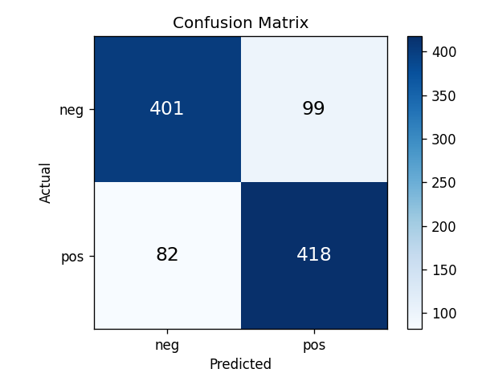
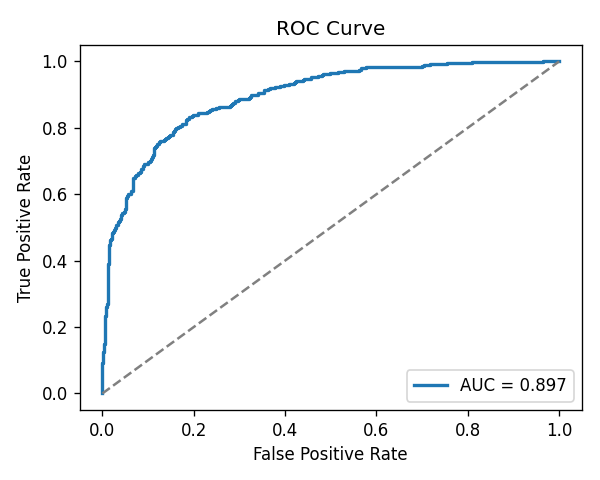

# Amazon Product Review Sentiment Analysis

An end-to-end NLP pipeline that classifies Amazon product reviews as **positive** or **negative** using TF-IDF feature engineering and Logistic Regression.

## Results

| Metric | Score |
|---|---|
| Accuracy | 91% |
| ROC-AUC | 0.913 |
| Precision (Positive) | 0.91 |
| Precision (Negative) | 0.91 |




## Dataset

Trained on the **Amazon Polarity dataset** — 3.6 million real product reviews labeled positive or negative. A balanced subset of 5,000 reviews is used by default for fast experimentation.

Source: [fancyzhx/amazon_polarity](https://huggingface.co/datasets/fancyzhx/amazon_polarity) on Hugging Face.

## Pipeline

```
Raw Review Text
      ↓
Text Preprocessing (lowercase, remove stopwords)
      ↓
TF-IDF Vectorization (unigrams + bigrams)
      ↓
Logistic Regression Classifier
      ↓
Prediction + Evaluation
```

## How to Run

```bash
pip install -r requirements.txt
python sentiment_analysis.py
```

## Project Structure

```
amazon-review-sentiment/
├── sentiment_analysis.py   # Main pipeline script
├── requirements.txt        # Dependencies
├── README.md
└── results/
    ├── confusion_matrix.png
    └── roc_curve.png
```

## Key Concepts

- **TF-IDF**: Converts raw text into numerical features. Down-weights common words ("the", "a") and up-weights rare but meaningful words ("terrible", "excellent"). Bigrams capture phrases like "not good" that single words miss.
- **Logistic Regression**: A linear classifier that learns a weight for each word/phrase. Chosen as a strong, interpretable baseline before reaching for deep learning.
- **ROC-AUC**: Measures ranking quality independent of classification threshold — more reliable than accuracy on real-world data.

## Extensions

- Swap Logistic Regression for `LinearSVC` or fine-tuned `DistilBERT` and compare
- Add a neutral class for 3-star reviews (3-class classification)
- Deploy as a web app using Streamlit
- Apply to other review domains (movies, restaurants, hotels)
